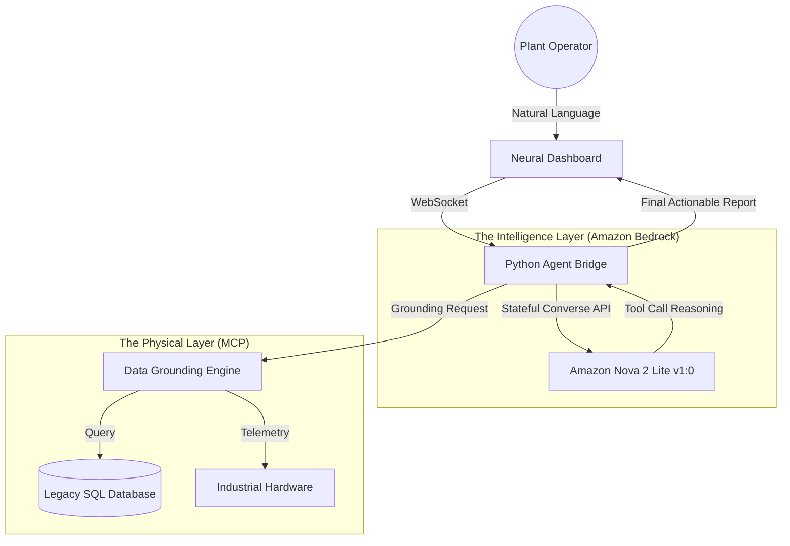

# AEGIS-CORE :: Neural Industrial Orchestrator
### *Bridging the Multi-Decade Gap Between Legacy Hardware and Agentic AI*

---

## 🌟 The Problem: The "Siloed" Industrial Reality
In modern manufacturing and energy plants, the most critical data is often trapped. It lives in legacy SQL databases from the 90s, proprietary sensor networks without APIs, and "black-box" PLC systems. 

Solving issues in these environments usually requires manual data entry, cross-referencing printed logs, and human operators acting as the only "integration layer." This process is slow, error-prone, and disconnected from the rapid pace of modern decision-making.

**AegisCore** was built for the **Amazon Nova Hackathon** to change this. We provide the "Neural Bridge" that finally connects these legacy systems to the world's most advanced reasoning engines.

---

## 🛡️ Project Vision
AegisCore is a mission-critical **Agentic AI** framework designed to orchestrate industrial automation. By using **Amazon Bedrock Nova 2 Lite**, we don't just provide a chatbot—we provide a digital supervisor that can see into your databases, feel your hardware's pulse, and execute complex cross-platform workflows safely.

---

## 🧩 Technical Architecture



---

## 🚀 The Core Innovation: "Agentic Grounding"

### 1. The Reasoning Engine: Nova 2 Lite
We selected the `us.amazon.nova-2-lite-v1:0` model for its exceptional ability to handle **Converse API Tool Use**. Unlike simpler models that hallucinate, Nova 2 Lite follows a strict "Observe-Orient-Decide-Act" (OODA) loop:
- **Observe**: Listens to the operator's natural language request.
- **Orient**: Identifies which legacy system (SQL or Sensor) has the answer.
- **Decide**: Formulates a structured tool call.
- **Act**: Interprets the raw hex/data results and translates them back to human terms.

### 2. The Model Context Protocol (MCP) Server
Grounding is everything. Our custom-built **MCP Server** acts as the translator. It converts legacy SQL rows and raw sensor voltages into "Clean JSON" that Nova can understand. 
- **Inventory Check**: Cross-references browser-extracted data with the master SQL inventory.
- **Hardware Telemetry**: Simulates real-time polling of temperature and vibration signatures for Industrial Sensors.

### 3. Human-In-The-Loop (HITL) Safety
In industry, a wrong click can be catastrophic. AegisCore implements a **Policy-Driven Gatekeeper**. Even if the AI determines a write-action is necessary, the system pauses, presents the reasoning in the "Orchestrator Logs," and requires a physical human signature (Approval) before the bridge executes the command.

---

## 💬 Demo Guide: Sample Prompts
To experience the true agentic power of AegisCore, try these prompts in the dashboard:

| Role | Operational Prompt | What the AI does behind the scenes |
| :--- | :--- | :--- |
| **Logistics** | *"Cross-reference the browser data with the legacy database and check if we have enough Control Valve B in stock."* | Extracts data, calls `cross_reference_inventory`, queries SQL, and summarizes the mismatch. |
| **Engineer** | *"Provide a full system health report and specifically check the telemetry for Industrial Sensor A."* | Calls `get_system_status` and `get_sensor_telemetry`, polls mock hardware, and generates a technical health diagnostic. |
| **Safety** | *"Are there any discrepancies in the sensor vibration levels across the plant?"* | Orchestrates multiple sensor checks to identify anomalies in the telemetry stream. |

---

## 🏗️ Deep Dive: The MCP Layer
The **Model Context Protocol (MCP)** is the "Hands" of our AI. It allows the model to interact with the world through two primary tools defined in `supervisor.py` and handled by `nova_act_mcp_server.py`:

- **`cross_reference_inventory`**:
  - **Inputs**: List of objects `{name: string, quantity: number}`.
  - **Logic**: Performs an exact match against the `legacy_inventory` SQLite table.
  - **Output**: Returns a list of `MISMATCH` or `NOT_IN_DB` findings.

- **`get_sensor_telemetry`**:
  - **Inputs**: `{sensor_name: string}`.
  - **Logic**: Simulates hardware polling via a randomizer to provide realistic Temperature and Vibration flux.
  - **Output**: Returns a simulated hardware state JSON.

---

## 📁 Project Detailed Structure

```bash
├── backend/
│   ├── agents/
│   │   ├── agent_api.py      # The WebSocket Bridge (The "Spinal Cord")
│   │   ├── supervisor.py     # The Orchestrator (The "Frontal Lobe")
│   ├── Dockerfile            # Container definition for the Bridge
│   ├── requirements.txt      # Python dependencies (boto3, websockets)
├── frontend/
│   ├── src/
│   │   ├── components/       # Reusable Atomic UI Components
│   │   ├── App.tsx           # Dashboard Orchestration & State
│   │   └── index.css         # Global Industrial Design System
├── mcp_examples/
│   └── nova_act_mcp_server.py # The Translator between AI and Data
├── .gitignore                # GitHub exclusion rules
└── README.md                 # This technical manifesto
```

---

## 📦 Deployment & Containerization

### Docker Deployment
AegisCore is ready for enterprise container environments. You can launch the backend bridge using:

```bash
cd backend
docker build -t aegis-bridge .
docker run -p 8765:8765 -e AWS_ACCESS_KEY_ID=XXX -e AWS_SECRET_ACCESS_KEY=XXX aegis-bridge
```

### GitHub Readiness
The project includes a comprehensive **`.gitignore`** to ensure that:
- ❌ **Secrets** (CSV files, credentials) are never pushed to the server.
- ❌ **Environment** folders (`venv`, `node_modules`) are excluded.
- ❌ **Artifacts** (Gemini brain logs) remain local.

---

## 🛠️ Installation & Manual Getting Started

### Prerequisites
- **AWS Bedrock Access**: Ensure `us.amazon.nova-2-lite-v1:0` is enabled in your region.
- **Python 3.10+** & **Node.js 18+**.

### 1. Launch the Neural Bridge (Backend)
```bash
cd backend/agents
pip install boto3 websockets
python agent_api.py
```

### 2. Launch the Dashboard (Frontend)
```bash
cd frontend
npm install
npm run dev
```

---

## 🛰️ Roadmap: Beyond the Hackathon
Our vision for the next 12 months includes:
- **Edge Deployment**: Running the Bridge on Greengrass devices.
- **Computer Vision**: Using Nova's multimodal capabilities to analyze thermal feeds.
- **Regulatory Logs**: Automated PDF reporting for safety audits.

---
*Developed for the Amazon Nova Hackathon 2026. Empowering the future of industrial intelligence.*
